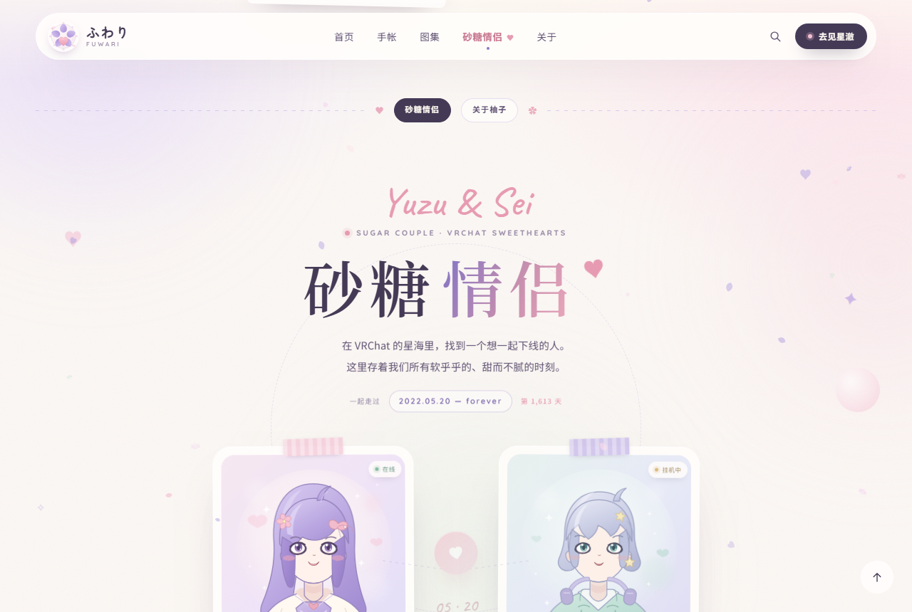
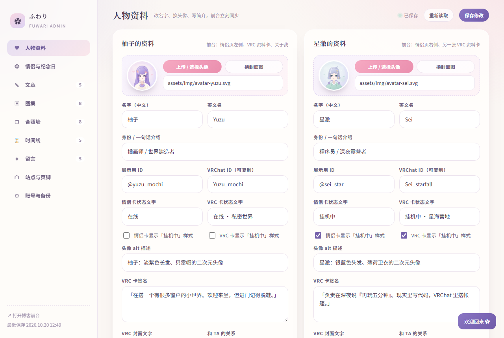
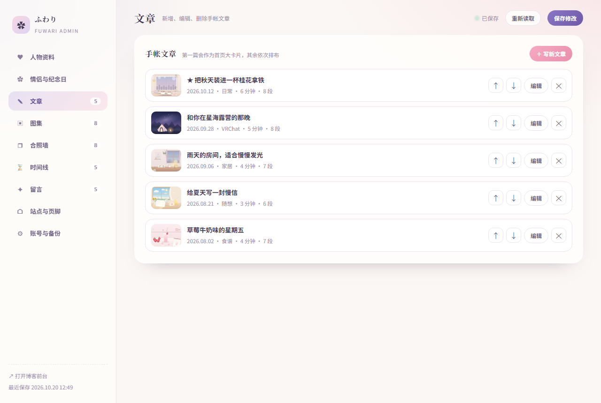

# ふわり Fuwari · 二次元个人博客 + 管理后台

治愈日系画风的个人博客：**博客首页** + **VRC「砂糖情侣」子页面**，附带一个零依赖的管理后台，可以在线修改人物姓名、头像、文章、图集、合照墙、纪念日、留言与站点文案。

- 主色：浅紫 `#b9a8e3` / 奶白 `#fbf7f4` / 淡粉 `#f3bfd1`
- 全站圆角柔和、玻璃拟态卡片、樱花 / 爱心 / 糖果粒子（canvas）
- 无任何第三方框架、无构建步骤，只需 Node 18+（内置 http / fs，无 npm 依赖）

| 首页 | 砂糖情侣 | 纪念日 |
| --- | --- | --- |
|  |  |  |

| 留言区 | 管理后台 | 文章管理 |
| --- | --- | --- |
|  |  |  |

---

## 一、启动

```bash
# 在项目根目录
node server/server.js
# 或
npm start
```

打开 <http://127.0.0.1:8787/> 即可。

| 地址 | 说明 |
| --- | --- |
| `/` | 博客首页（导航里「砂糖情侣」直达情侣页） |
| `/index.html#couple` | 直接落到砂糖情侣区 |
| `/couple.html` | 情侣页独立入口（会跳转到 `/#couple`） |
| `/admin.html` | 管理后台 |

首次启动会自动生成 `data/content.json`（站点内容）与 `data/auth.json`（账号口令哈希）。

### 环境变量

| 变量 | 默认值 | 说明 |
| --- | --- | --- |
| `PORT` | `8787` | 端口 |
| `HOST` | `127.0.0.1` | 监听地址，想用手机在同一局域网访问就设成 `0.0.0.0` |
| `SITE_URL` | 空 | 填了会出现在后台的站点信息里（如 `https://blog.example.com`） |
| `FUWARI_MAX_UPLOAD_MB` | `8` | 单张图片上传上限 |
| `FUWARI_DATA_DIR` | `./data` | 数据目录，想丢到别处就改这里 |
| `FUWARI_ADMIN_ORIGINS` | 空 | 允许远程登录后台的前台域名，逗号分隔（见下文「前台在 GitHub Pages、后台在自己的服务器」） |

---

## 二、管理后台

1. 打开 <http://127.0.0.1:8787/admin.html>
2. 默认账号 **admin / fuwari2026**（第一次启动时创建）

> ⚠️ 请第一时间在后台「账号与备份」里改掉默认口令。口令用 scrypt 加盐哈希后存在 `data/auth.json`，不会明文落盘。
> 忘记口令时：运行 `node server/setup-admin.js 用户名 新口令`（或 `node server/setup-admin.js` 交互输入），会直接覆盖 `data/auth.json`；也可以删掉该文件后重跑同一个脚本。

### 后台能改什么

| 标签页 | 内容 |
| --- | --- |
| 人物资料 | 柚子 / 星澈 / 主人的名字、昵称、@账号、VRChat ID、头像、封面、简介、标签 |
| 情侣与纪念日 | 情侣页大标题、双方头像位、开始日期（纪念日天数与「第 N 个 5·20」自动计算）、情书文案 |
| 文章 | 新增 / 编辑 / 删除 / 排序，封面、标签、日期、正文分块（段落 / 小标题 / 引用 / 列表） |
| 图集 | 图片、标题、说明、比例（宽 / 高 / 方） |
| 合照墙 | 拍立得照片与手写注释 |
| 时间线 | 情侣页时间线条目 |
| 留言 | 查看、置顶、删除访客留言 |
| 站点与页脚 | 站点名、副标题、滚动语录、关于我、技能标签、页脚链接、备案文字 |
| 账号与备份 | 改口令、导出 / 导入 `content.json` 备份 |

修改后点右上角「保存修改」，前台刷新即生效（前台每次打开都会拉取最新 `content.json`，没有缓存延迟）。

图片上传：在任意图片字段旁点「上传」，文件存到 `uploads/`，正文里引用即可。

### 前台托管在 GitHub Pages、后台在自己的服务器

这种组合最常见：博客页面白嫖 GitHub Pages，数据和后台放在自己的小服务器上。

1. **服务器**上按 [DEPLOY.md](DEPLOY.md) 部好，并允许 Pages 域名跨域登录：

   ```bash
   FUWARI_ADMIN_ORIGINS=https://你的用户名.github.io
   ```

   （systemd 里写在 `Environment=` 一行即可；有多个域名用逗号分隔。）

2. **本地**跑一次下面这条命令，把后端地址写进 `assets/js/api-config.js`：

   ```bash
   node tools/set-api-base.js https://你的服务器域名
   ```

   然后 `git add assets/js/api-config.js && git commit && git push`，等 Pages 重新部署。
   之后 Pages 上的首页、砂糖情侣页都会**直接读服务器上的实时数据**，不再走只读的 `content.json`。

3. **进后台**用 `https://你的用户名.github.io/仓库名/public/admin.html`（发布时整个仓库都会上 Pages，后台在 `public/` 里）。
   也可以临时在地址后面加 `?api=https://你的服务器域名`，不用改文件也能连。

> 注意：如果服务器还没配 HTTPS，Chrome / Edge / Safari 会拦掉「HTTPS 页面请求 HTTP 接口」（混合内容 + 本地网络访问限制），表现就是后台登录后一直转圈、首页也不显示数据。所以服务器务必按 DEPLOY.md 配好证书；配好之前只能用 `http://你的域名/` 或本地 `npm start` 打开后台。

### 完全不部署服务器，也能在网页上改内容

不配 `api-config.js` 时，Pages 上的后台会**自动进入「本机模式」**：

- 打开 `https://你的用户名.github.io/仓库名/public/admin.html`，直接就能编辑人物、文章、图集、合照、时间线（数据来自仓库里的 `content.json`）。
- 点「保存修改」后，内容存在**这台电脑的浏览器**里，刷新前台页面立刻能看到效果；换电脑或换浏览器就看不到。
- 顶栏的「导出 content.json」会把当前内容下载下来，覆盖仓库根目录的 `content.json` 再 push，就变成所有人可见了。图片得手动放进 `uploads/`（README 前面说过命名要对上）。
- 留言永远只存在访客自己的浏览器里，要真正收留言还是得有服务器。

想完全本地玩，也可以 `npm start` 后在 <http://127.0.0.1:8787/admin.html> 编辑（这才是完整版：账号、上传图片、真实留言）。

---

## 三、目录结构

```
.
├── index.html              # 首页（含砂糖情侣区）
├── couple.html             # 情侣页入口跳转壳（防止旧链接失效）
├── assets/
│   ├── css/  style.css     首页与全站基础样式
│   │         couple.css    砂糖情侣页样式
│   │         responsive.css 响应式断点
│   ├── js/   content.js    读取后台数据并渲染各区块
│   │         api-config.js  后端地址（`node tools/set-api-base.js` 生成）
│   │         main.js       粒子、阅读弹窗、搜索、灯箱、滚动动画
│   │         couple.js     倒计时、纪念日、留言区
│   └── img/  *.svg         原创手绘插画（头像、场景、logo）
├── data/
│   ├── content.json        站点全部内容（后台读写的就是它）
│   └── auth.json           账号口令哈希（不进版本库）
├── uploads/                后台上传的图片
├── public/
│   ├── admin.html/.css/.js 管理后台单页
├── server/
│   ├── server.js           零依赖静态服务 + REST API
│   ├── setup-admin.js      初始化 / 重置口令的脚本
│   ├── migrate-static.js   把旧静态站的图片绝对路径改成相对路径
│   └── lib/                auth 鉴权 · http 响应与上传 · store JSON 存储 · defaults 默认内容
├── deploy.sh               一键部署脚本（Ubuntu / Debian）
├── tools/
│   └── set-api-base.js     写入 / 清空 api-config.js 里的后端地址
├── DEPLOY.md               部署与运维指南
└── package.json
```

## 四、接口一览

| 方法 | 路径 | 鉴权 | 说明 |
| --- | --- | --- | --- |
| GET | `/api/content` | 否 | 站点内容（支持 `?callback=fn` JSONP，方便纯静态托管时读取） |
| POST | `/api/notes` | 否 | 访客留言（限频） |
| POST | `/api/notes/like` | 否 | 留言点赞 |
| POST | `/api/login` | 否 | 登录，成功下发 HttpOnly Cookie |
| POST | `/api/logout` | 是 | 退出登录 |
| GET | `/api/session` | 否 | 当前登录状态 |
| PUT | `/api/content` | 是 | 整体保存内容（带 CSRF 校验） |
| POST | `/api/content/reset` | 是 | 恢复默认内容 |
| POST | `/api/image` | 是 | 上传图片（原始二进制），返回 `{url}` |
| GET | `/api/uploaded` | 是 | 列出已上传图片 |
| GET | `/api/backup` | 是 | 下载内容备份 |
| POST | `/api/password` | 是 | 修改口令 |

## 五、部署小提示

- 放到公网时建议用 Nginx / Caddy 反代并加 HTTPS，`HOST` 保持 `127.0.0.1`。
- `data/` 与 `uploads/` 记得备份；`data/auth.json` 不要提交到公开仓库。
- 如果只想托管静态页面（GitHub Pages 等），把 `assets/`、`index.html` 和 `data/content.json` 一起部署即可，后台改内容后重新上传 `content.json`。

---

## 六、部署到服务器

完整步骤见 [DEPLOY.md](DEPLOY.md)（Ubuntu + systemd + Nginx + HTTPS），也可以直接跑一键脚本：

```bash
# 文件传到 /opt/fuwari 后
sudo bash deploy.sh 你的域名
```

如果只能放静态文件（GitHub Pages / 对象存储），把 `index.html`、`assets/`、`uploads/`、`content.json` 一起上传就行——前台会自动检测没有 `/api/content` 并改读 `./content.json`，无需改配置。
静态模式下留言和点赞存在本地 localStorage（只对本机可见），接口与服务端逻辑不变，换回 VPS 后自动恢复真实留言。

---

Made with 🍬 — ふわり Fuwari
